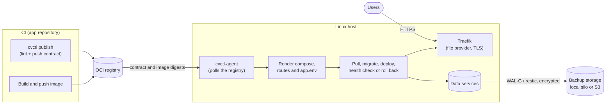

<div align="center">


# cvctl

**Pull-based GitOps for Docker Compose on a single Linux host.**

[](https://github.com/Codeavers/cvctl/releases)
[](https://github.com/Codeavers/cvctl/actions/workflows/ci.yml)
[](LICENSE)
[](go.mod)
[](https://github.com/Codeavers/cvctl/pkgs/container/cvctl)

[Documentation](doc/README.md) · [Releases](https://github.com/Codeavers/cvctl/releases) · [Changelog](CHANGELOG.md) · [Security](SECURITY.md)

</div>

## What is cvctl?

cvctl is a CLI and a pull agent that prepares a Linux host with systemd and keeps Docker Compose
projects deployed on it. CI publishes images and a contract (`compose.yml` plus `env.spec.yml`) as
OCI artifacts; the agent on the host pulls them, deploys, verifies and rolls back on its own. CI
never needs SSH or any other inbound access to the server, and the host only runs what the
contract allowlist accepts.

## Features

- **Pull-based agent**: `cvctl-agent` polls the registry, follows the contract's `develop` tag in
  dev and `main` in prod, and deploys what changed.
- **OCI contracts**: `cvctl lint` checks the contract against an allowlist and `cvctl publish`
  pushes it as an OCI artifact; cvctl generates the compose file it runs.
- **Blue-green or recreate**: zero-downtime swaps for exposed services, health checks, migration
  hooks and automatic rollback when a deploy fails.
- **Data services**: `postgres`, `postgis`, `mysql`, `mariadb`, `mongodb`, `redis`, `valkey`,
  `rabbitmq`, `nats`, `s3` and `sqlite`, on the host or external (managed Postgres, R2, S3).
- **Encrypted backups with PITR**: WAL-G for Postgres, restic for dumps, volumes and env files,
  restore points before each prod deploy, `backup verify` and rebuilding an instance on a new host
  from off-site backups.
- **Traefik with automatic TLS**: file provider only, no Docker socket; Let's Encrypt over HTTP,
  Route53 or Cloudflare, or behind another proxy. `cvctl adopt` exposes services cvctl does not
  deploy.
- **Host hardening**: `cvctl init` sets up Docker, accounts, SSH with an auto-revert timer,
  fail2ban, UFW and unattended upgrades, idempotently.
- **Safe self-upgrade**: `cvctl upgrade` shows what the new release would change per instance,
  watches the agent and puts the old binary back if it does not hold.
- **Deploy notices**: Telegram messages with the PR, commit and author, the cause of a failure and
  the next command to run.
- **Image pruning**: keeps the last three versions that ran per service and removes the rest.

## Quickstart

On the host (Ubuntu or Debian for a full setup):

```sh
ARCH=amd64                           # amd64 or arm64
curl -fsSLO "https://github.com/Codeavers/cvctl/releases/latest/download/cvctl-linux-${ARCH}"
chmod +x "cvctl-linux-${ARCH}"
sudo "./cvctl-linux-${ARCH}" init    # installs /usr/local/bin/cvctl and the cvctl-agent service
```

In the app's infra repository, usually from CI with `CVCTL_PUBLISH_TOKEN` or `GITHUB_TOKEN` set
([template](examples/ci/publish-contract.yml)):

```sh
cvctl lint ./infra
cvctl publish ./infra ghcr.io/<org>/<repo>-infra:develop
```

Back on the host:

```sh
sudo cvctl project add oci://ghcr.io/<org>/<repo>-infra --env dev --domain web=app.example.com
cvctl status
```

Checksums, GHCR images and every `init` option are in [doc/install.md](doc/install.md).

## How it works



## Comparison

A rough guide based on each project's public documentation; corrections are welcome.

| | cvctl | Dokploy | Coolify | Kamal |
| --- | --- | --- | --- | --- |
| Interface | CLI and agent | Web UI | Web UI | CLI |
| Deploy model | Host pulls from a registry | Server builds or pulls on a webhook or UI action | Server builds or pulls on a webhook or UI action | Pushed over SSH from a workstation or CI |
| Inbound access to deploy | None (the host pulls) | Webhook to the control server, SSH from it to remote servers | Webhook to the control server, SSH from it to remote servers | SSH from the deploying machine to every host |
| Scope | One host per agent | Multiple servers | Multiple servers | Multiple hosts |
| Compose file | Allowlisted fields, regenerated by cvctl | Your Compose file | Your Compose file | Own config (`deploy.yml`) |
| Database backups | Encrypted, PITR (WAL-G), restore checks | Scheduled backups to S3 | Scheduled backups to S3 | Not built in |

## Documentation

| Topic | Covers |
| --- | --- |
| [Install and prepare a host](doc/install.md) | binary, `cvctl init`, host configuration, notifications |
| [Project contract](doc/contract.md) | `compose.yml`, `env.spec.yml`, `lint`, `publish`, `render` |
| [Deploy](doc/deploy.md) | `project add/update/list`, `plan`, strategies, timeouts, migrating |
| [Domains and Traefik](doc/domains.md) | domains, edge modes, Traefik, `adopt` |
| [Data services](doc/data.md) | data kinds, `sqlite`, S3 buckets |
| [Backups and recovery](doc/backups.md) | backups, restore, disaster recovery, secrets bundle |
| [Operations](doc/operations.md) | status, logs, notices, `upgrade`, upgrade notes, `images prune` |
| [Security model](doc/security.md) | who runs what, isolation, secrets, hardening |

## Contributing

Bug reports, ideas and pull requests are welcome; read [CONTRIBUTING.md](CONTRIBUTING.md) first and
follow the [Code of Conduct](CODE_OF_CONDUCT.md). Checks run locally before a push, not on pull
requests: enable the pre-push hook once per clone with `git config core.hooksPath .githooks`.

## Security

Report vulnerabilities privately as described in [SECURITY.md](SECURITY.md), not in a public issue.
How cvctl protects hosts and secrets is in [doc/security.md](doc/security.md).

## License

Apache License 2.0, see [LICENSE](LICENSE).
